<p align="right"><a href="README.md">English</a> · <b>Français</b></p>

<p align="center"><a href="https://samuelguda4.github.io/NTL_Mauritius_Project/fr/">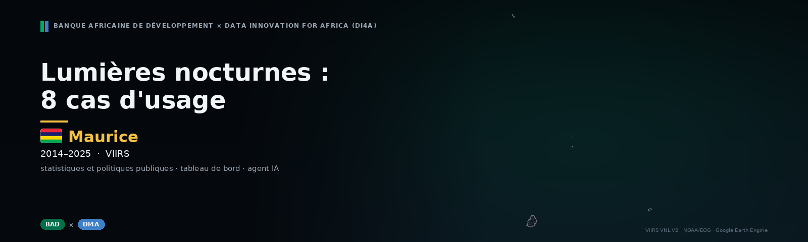</a></p>

<p align="center">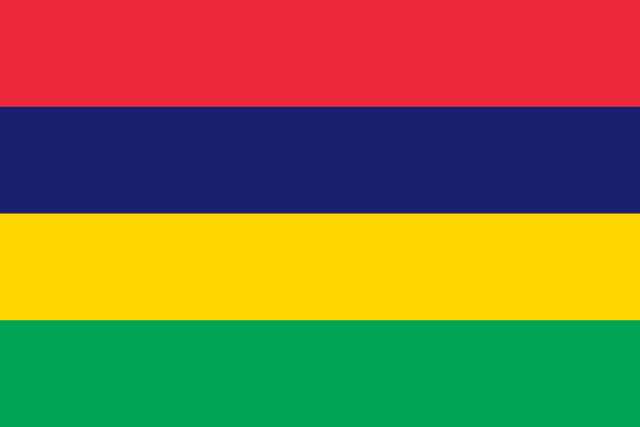<br><b>Maurice</b> · 2014–2025</p>

<p align="center">Transformer les lumières nocturnes observées par satellite en éclairages pour <b>Maurice</b> — <b>huit cas d'usage</b> au service des statistiques et des politiques publiques : dynamiques économiques, croissance régionale, prévision du PIB, chocs et résilience, inégalités et électrification, zones industrielles, tourisme saisonnier, urbanisation — avec un <b>tableau de bord public</b> et un <b>agent IA</b> qui ne répond qu'à partir des chiffres publiés.</p>

<p align="center">
  <a href="https://samuelguda4.github.io/NTL_Mauritius_Project/fr/"></a>
  <a href="https://colab.research.google.com/github/samuelguda4/NTL_Mauritius_Project/blob/main/notebooks/NTL_8_use_cases_FR.ipynb"></a>
  <a href="LICENSE"></a>
  <a href="README.md"></a>
  <a href="docs/methodology.fr.md"></a>
  <a href="https://samuelguda4.github.io/NTL_Mauritius_Project/fr/?country=MUS#assistant"></a>
  <a href="CHANGELOG.md"></a>
</p>

<p align="center"><a href="https://samuelguda4.github.io/NTL_Mauritius_Project/fr/"></a>&nbsp;&nbsp;<a href="https://colab.research.google.com/github/samuelguda4/NTL_Mauritius_Project/blob/main/notebooks/NTL_8_use_cases_FR.ipynb"></a></p>

<p align="center"><a href="https://samuelguda4.github.io/NTL_Mauritius_Project/fr/"><b>https://samuelguda4.github.io/NTL_Mauritius_Project/fr/</b></a></p>


## ✨ En un coup d'œil

<sub>Chiffres clés de l'exécution, 2014–2025. Chacun est accompagné de son niveau de confiance et de sa méthode sur le tableau de bord.</sub>

<table>
<tr>
<td align="center" width="25%"><h3>+6,6 %</h3><b>Croissance annuelle de la lumière</b><br><sub>2014–2025, pente robuste (Theil–Sen)</sub></td>
<td align="center" width="25%"><h3>−6,6 %</h3><b>12 derniers mois vs 12 précédents</b><br><sub>série désaisonnalisée, jusqu'à 12/2025</sub></td>
<td align="center" width="25%"><h3>2,21</h3><b>Élasticité lumière–PIB</b><br><sub>IC 95 % 1,24 à 3,18 · confiance moyenne</sub></td>
<td align="center" width="25%"><h3>0,23</h3><b>Gini de la lumière par habitant</b><br><sub>unités ADM2, 2025</sub></td>
</tr>
<tr>
<td align="center" width="25%"><h3>3 k</h3><b>Personnes dans le noir</b><br><sub>6 % de la population habitée, 2025</sub></td>
<td align="center" width="25%"><h3>22 %</h3><b>Part de la 1ʳᵉ région</b><br><sub>Plaines Wilhems, 2025</sub></td>
<td align="center" width="25%"><h3>16</h3><b>Grappes industrielles</b><br><sub>17 % de la lumière nationale</sub></td>
<td align="center" width="25%"><h3>0</h3><b>Zones touristiques</b><br><sub>surcroît estival max, +5 % (Plaines Wilhems (Plaines Wilhems))</sub></td>
</tr>
<tr>
<td align="center" width="25%"><h3>+3,9 %</h3><b>Surface éclairée</b><br><sub>croissance annuelle ; population +0,1 %/an</sub></td>
</tr>
</table>


## ⚡ Un choc vu de l'espace

<p align="center">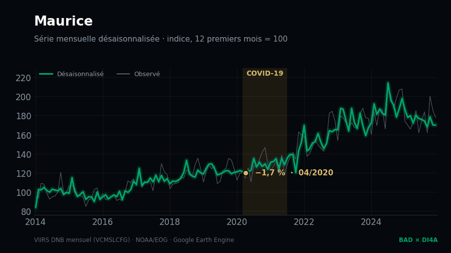<br><sub>Série mensuelle nationale désaisonnalisée — COVID-19. Creux : −1,7 % (04/2020).</sub></p>


## 🧭 Huit cas d'usage

<sub>Chaque carte ouvre la page correspondante du tableau de bord.</sub>

<table>
<tr>
<td width="50%" valign="top">
<a href="https://samuelguda4.github.io/NTL_Mauritius_Project/fr/?country=MUS#time">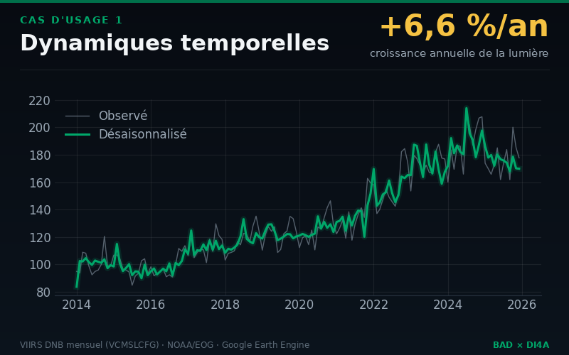</a>
<h3>📈 1 · Dynamiques temporelles</h3>
<p><b>Question</b> — <i>L'activité accélère-t-elle ou ralentit-elle, hors effet de saison ?</i></p>
<p><b>Résultat</b> — Entre 2014 et 2025, la lumière nocturne de Maurice a évolué de +6,6 % par an (IC 95 % : +4,7 % à +7,9 %). Sur les 12 derniers mois, le niveau désaisonnalisé est -6,6 % par rapport aux 12 mois précédents.</p>
<p><a href="https://samuelguda4.github.io/NTL_Mauritius_Project/fr/?country=MUS#time">Ouvrir la page →</a></p></td>
<td width="50%" valign="top">
<h3>🗺️ 2 · Croissance régionale et convergence</h3>
<p><b>Question</b> — <i>Quelles régions décollent, lesquelles décrochent ?</i></p>
<p><b>Résultat</b> — Sur 12 unités ADM2, 10 sont en croissance significative, 1 stagnent et 0 déclinent. L'activité lumineuse reste concentrée : Plaines Wilhems concentre 22 % de la lumière nationale.</p>
<p><a href="https://samuelguda4.github.io/NTL_Mauritius_Project/fr/?country=MUS#regions">Ouvrir la page →</a></p></td>
</tr>
<tr>
<td width="50%" valign="top">
<a href="https://samuelguda4.github.io/NTL_Mauritius_Project/fr/?country=MUS#time">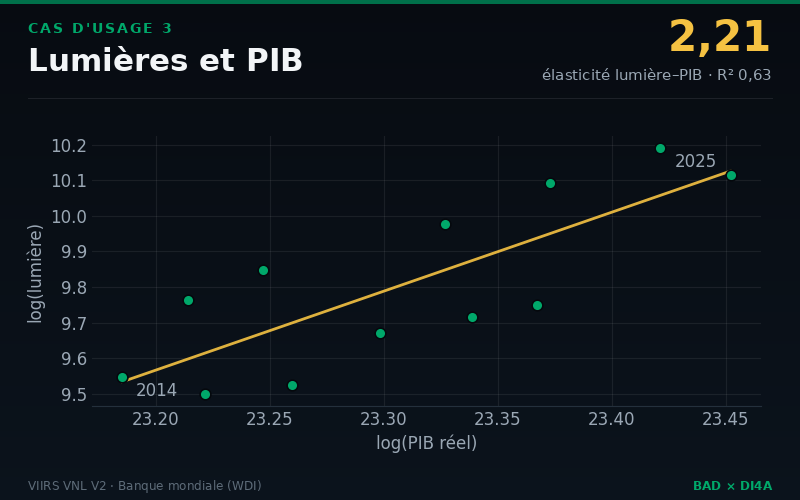</a>
<h3>💹 3 · Relation lumières–PIB</h3>
<p><b>Question</b> — <i>Peut-on estimer la croissance avant sa publication, et le PIB régional ?</i></p>
<p><b>Résultat</b> — L'élasticité de la lumière au PIB réel est de 2,21 en niveaux (IC 95 % : 1,24 à 3,18, R² = 0,63, 12 années) et de 0,34 en taux de croissance (IC : 0,01 à 0,66).</p>
<p><a href="https://samuelguda4.github.io/NTL_Mauritius_Project/fr/?country=MUS#time">Ouvrir la page →</a></p></td>
<td width="50%" valign="top">
<a href="https://samuelguda4.github.io/NTL_Mauritius_Project/fr/?country=MUS#shocks">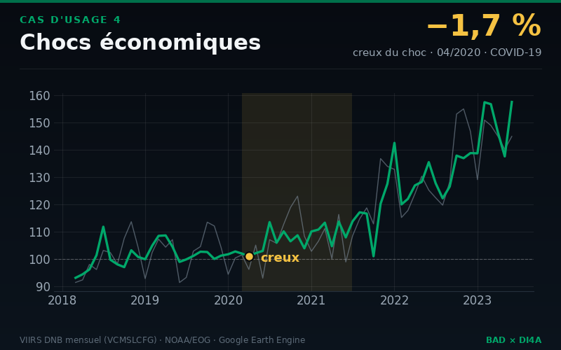</a>
<h3>⚡ 4 · Chocs et résilience</h3>
<p><b>Question</b> — <i>Quelle a été la profondeur d'un choc, et la vitesse de récupération ?</i></p>
<p><b>Résultat</b> — Le choc le plus marqué dans la série désaisonnalisée est « COVID-19 » : creux de -1,7 % (04/2020), retour au niveau d'avant-choc après 3 mois.</p>
<p><a href="https://samuelguda4.github.io/NTL_Mauritius_Project/fr/?country=MUS#shocks">Ouvrir la page →</a></p></td>
</tr>
<tr>
<td width="50%" valign="top">
<h3>⚖️ 5 · Inégalités et électrification</h3>
<p><b>Question</b> — <i>Où vivent les populations privées d'électricité ?</i></p>
<p><b>Résultat</b> — Le Gini de la lumière par habitant (ADM2) vaut 0,23 en 2025 (évolution non significative depuis 2014). Environ 0,00 million(s) de personnes vivent dans des zones habitées sans lumière détectable (6 % de la population habitée).</p>
<p><a href="https://samuelguda4.github.io/NTL_Mauritius_Project/fr/?country=MUS#inequality">Ouvrir la page →</a></p></td>
<td width="50%" valign="top">
<a href="https://samuelguda4.github.io/NTL_Mauritius_Project/fr/?country=MUS#industry">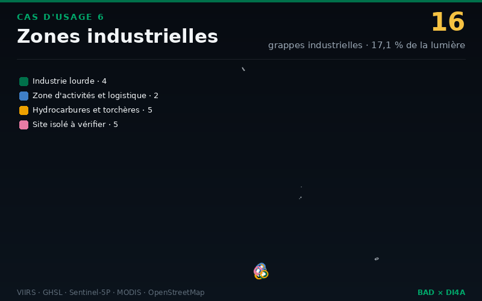</a>
<h3>🏭 6 · Zones industrielles</h3>
<p><b>Question</b> — <i>Où est l'industrie, et son activité progresse-t-elle ?</i></p>
<p><b>Résultat</b> — 16 grappes industrielles détectées par concordance de signaux satellitaires : 4 d'industrie lourde, 2 zones d'activités et de logistique, 5 sites d'hydrocarbures et 5 sites isolés à vérifier.</p>
<p><a href="https://samuelguda4.github.io/NTL_Mauritius_Project/fr/?country=MUS#industry">Ouvrir la page →</a></p></td>
</tr>
<tr>
<td width="50%" valign="top">
<a href="https://samuelguda4.github.io/NTL_Mauritius_Project/fr/?country=MUS#tourism">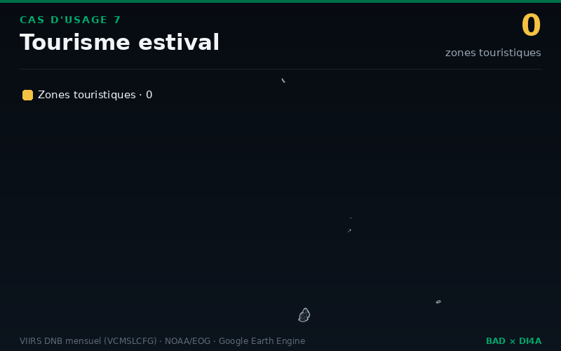</a>
<h3>🏖️ 7 · Tourisme saisonnier</h3>
<p><b>Question</b> — <i>Quelles zones vivent du tourisme, et comment évolue la saison ?</i></p>
<p><b>Résultat</b> — Aucune unité ne montre de surcroît estival net significatif : pas de saison touristique visible depuis l'espace.</p>
<p><a href="https://samuelguda4.github.io/NTL_Mauritius_Project/fr/?country=MUS#tourism">Ouvrir la page →</a></p></td>
<td width="50%" valign="top">
<h3>🏙️ 8 · Signaux d'urbanisation</h3>
<p><b>Question</b> — <i>Où les villes s'étendent-elles, où les villages s'électrifient-ils, et où la population croît-elle sans lumière ?</i></p>
<p><b>Résultat</b> — Surface éclairée nationale : +3,9 % par an ; population : +0,1 % par an. Classes (ADM2) : Urbanisation électrifiée 9, Stable ou en déclin 2, Indéterminé 1.</p>
<p><a href="https://samuelguda4.github.io/NTL_Mauritius_Project/fr/?country=MUS#urban">Ouvrir la page →</a></p></td>
</tr>
<tr>
<td width="50%" valign="top"><h3>🤖 Agent IA</h3><p><i>Interrogez les résultats en langage naturel — chaque chiffre est cité.</i></p><p><a href="https://samuelguda4.github.io/NTL_Mauritius_Project/fr/?country=MUS#assistant">Ouvrir la page →</a></p></td>
</tr>
</table>


## 📊 Le tableau de bord

<sub>Bilingue (FR/EN), fichiers statiques, thèmes clair et sombre, adapté au mobile.</sub>

<table><tr><td width="76%"><a href="https://samuelguda4.github.io/NTL_Mauritius_Project/fr/">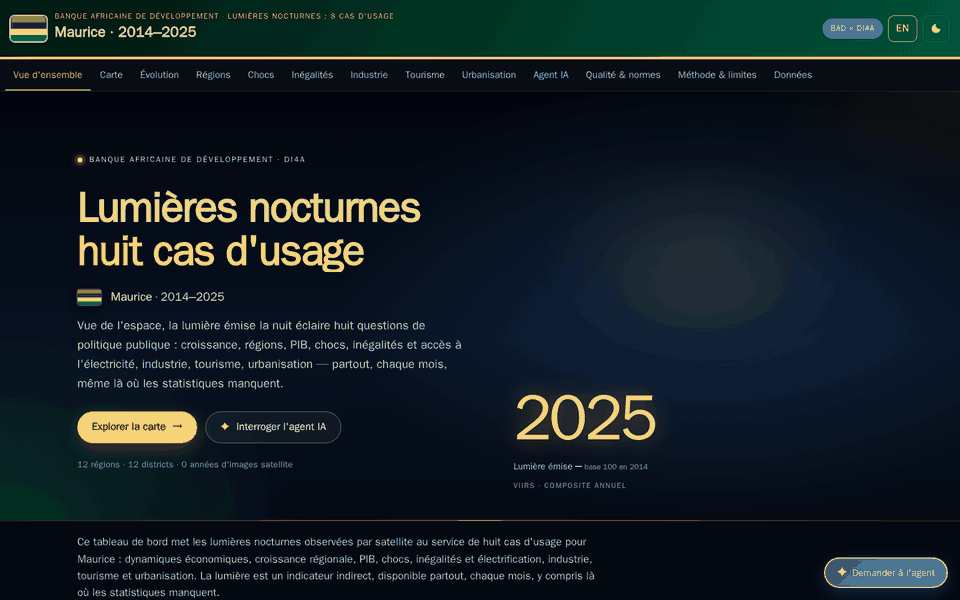</a></td><td width="24%">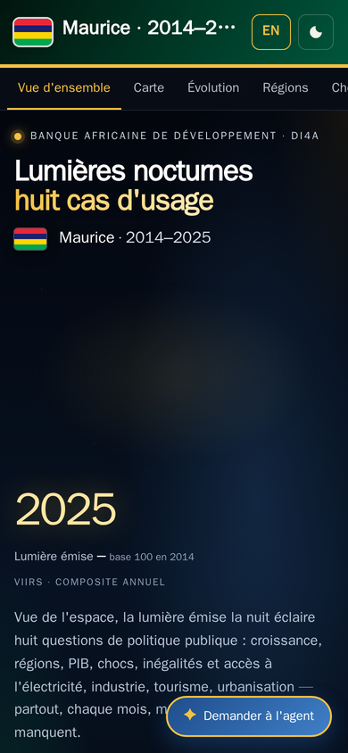</td></tr></table>


<details>
<summary><b>Captures d'écran</b> (9)</summary>
<br>

<table>
<tr><td width="33%" align="center"><a href="https://samuelguda4.github.io/NTL_Mauritius_Project/fr/?country=MUS#overview">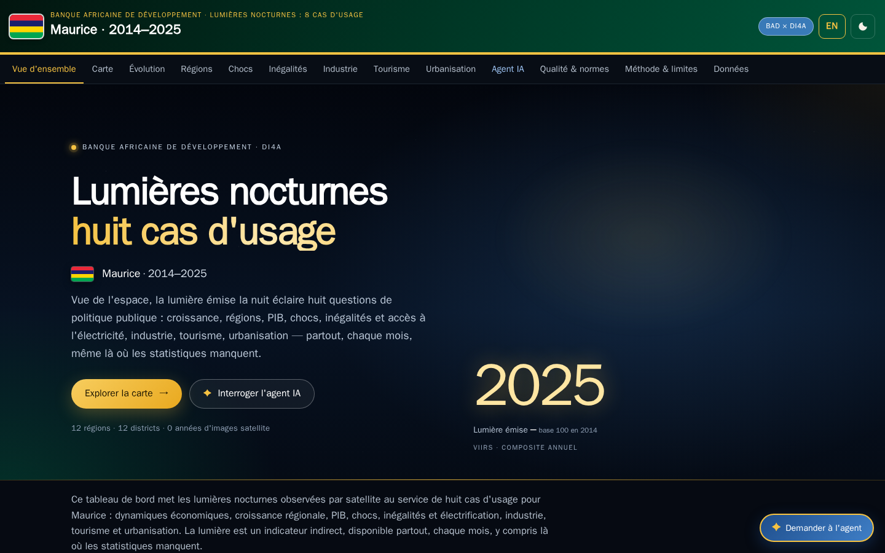</a><br><sub><code>#overview</code></sub></td><td width="33%" align="center"><a href="https://samuelguda4.github.io/NTL_Mauritius_Project/fr/?country=MUS#map">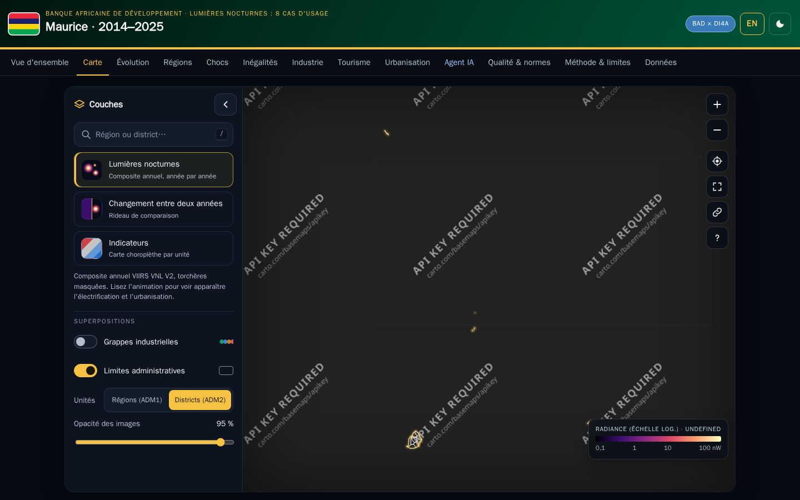</a><br><sub><code>#map</code></sub></td><td width="33%" align="center"><a href="https://samuelguda4.github.io/NTL_Mauritius_Project/fr/?country=MUS#time">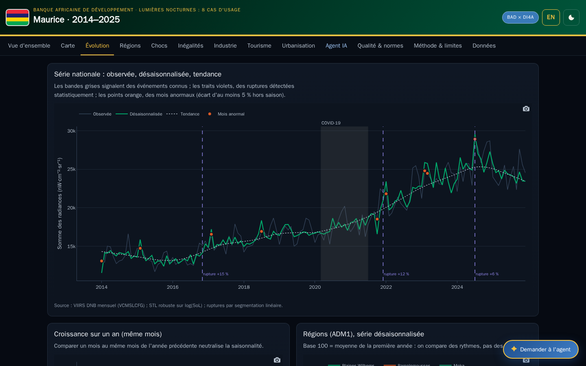</a><br><sub><code>#time</code></sub></td></tr>
<tr><td width="33%" align="center"><a href="https://samuelguda4.github.io/NTL_Mauritius_Project/fr/?country=MUS#regions">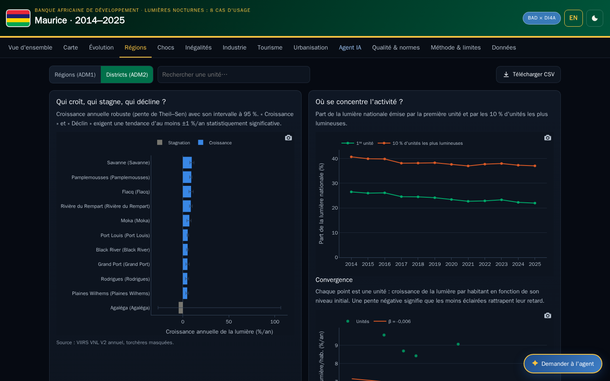</a><br><sub><code>#regions</code></sub></td><td width="33%" align="center"><a href="https://samuelguda4.github.io/NTL_Mauritius_Project/fr/?country=MUS#shocks">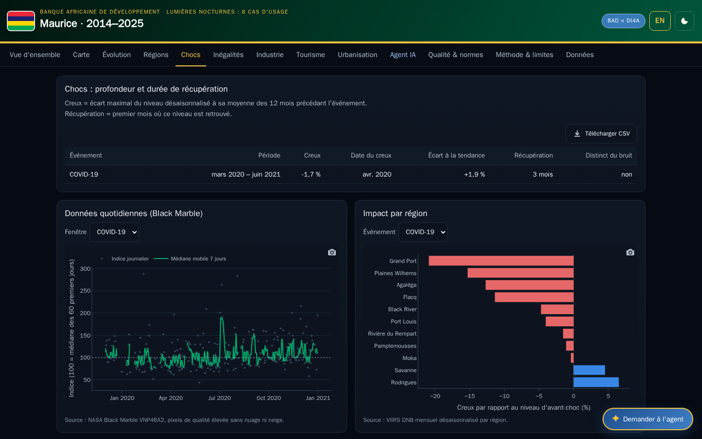</a><br><sub><code>#shocks</code></sub></td><td width="33%" align="center"><a href="https://samuelguda4.github.io/NTL_Mauritius_Project/fr/?country=MUS#inequality">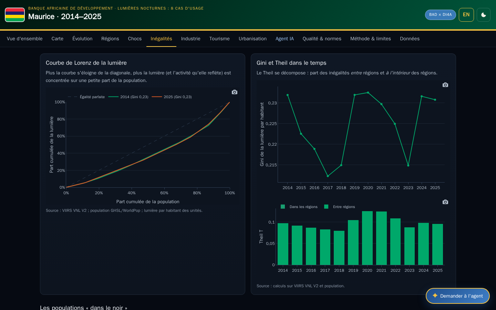</a><br><sub><code>#inequality</code></sub></td></tr>
<tr><td width="33%" align="center"><a href="https://samuelguda4.github.io/NTL_Mauritius_Project/fr/?country=MUS#industry">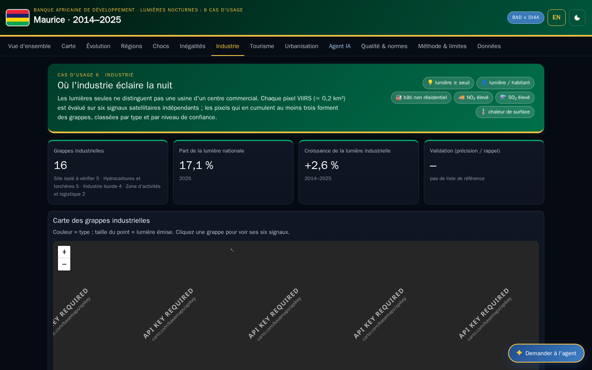</a><br><sub><code>#industry</code></sub></td><td width="33%" align="center"><a href="https://samuelguda4.github.io/NTL_Mauritius_Project/fr/?country=MUS#tourism">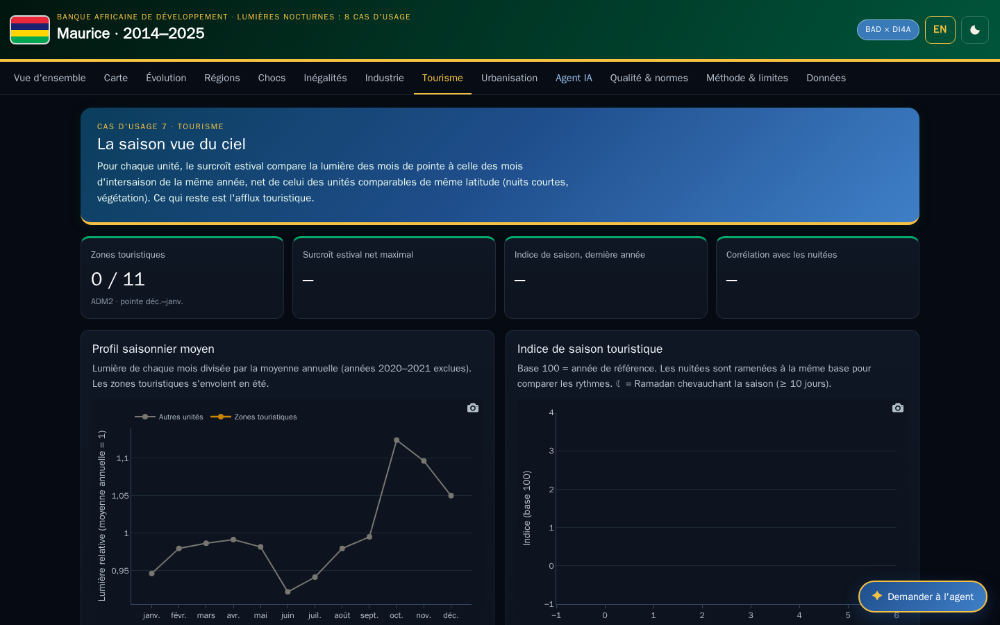</a><br><sub><code>#tourism</code></sub></td><td width="33%" align="center"><a href="https://samuelguda4.github.io/NTL_Mauritius_Project/fr/?country=MUS#urban">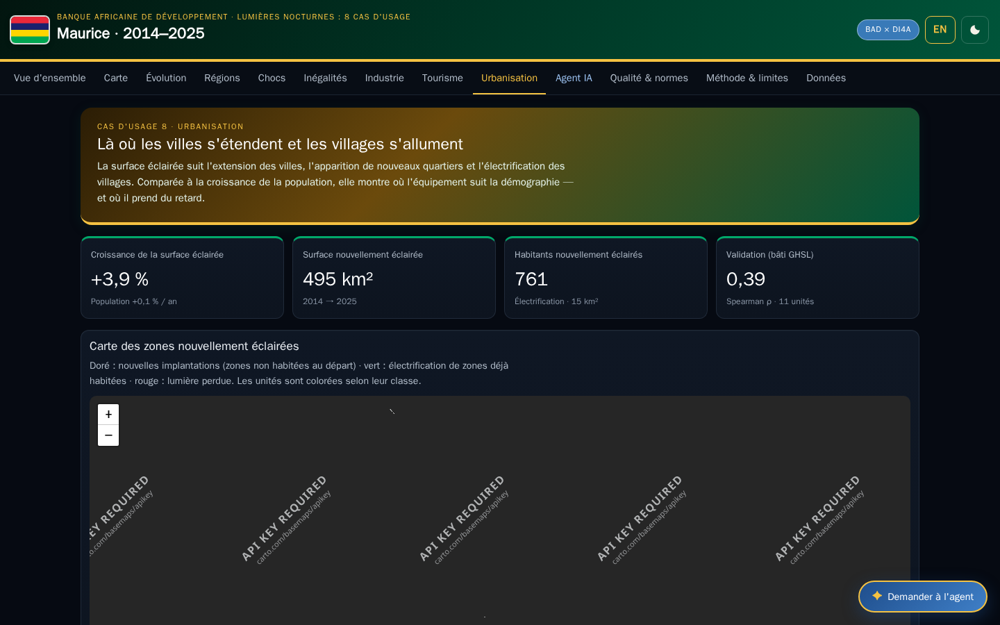</a><br><sub><code>#urban</code></sub></td></tr>
</table>
</details>


## 🤖 L'agent IA

- **Ancré dans les résultats.** L'agent répond uniquement à partir des faits numérotés exportés avec le tableau de bord (`agent_context.json`, F01, F02…) : les mêmes dans le notebook et sur le site.
- **Sourcé.** Chaque phrase chiffrée cite son fait, par ex. `[F12]` ; les citations renvoient à la page du tableau de bord concernée, et les citations inconnues sont supprimées.
- **Un véritable agent à six outils.** Il planifie, appelle ses outils (*function calling*) et enchaîne plusieurs étapes : 🔎 `search_facts`, 🏆 `rank_units`, 📍 `unit_profile`, ⚖️ `compare_units`, 📈 `make_chart` (graphiques dans la conversation) et 🗺️ `map_action` (il pilote la carte : année, rideau avant/après, zoom, couches). Chaque étape est affichée ; les résultats d'outils sont cités `[D2]`.
- **Des notes en un clic.** Note pour un décideur, fiche pays ou réponse parlementaire — structurées, sourcées, exportables en Markdown ou PDF.
- **Le modèle de votre choix.** Groq (`openai/gpt-oss-120b` par défaut), Google Gemini ou un modèle local Ollama, avec réponses en continu ; sans modèle, un planificateur hors ligne exécute les mêmes outils.
- **Garde-fous.** Outils en lecture seule, cinq appels d'outils au plus par question, données jamais traitées comme des instructions (résistance à l'injection de consignes), limitation du débit.
- **Vos clés restent chez vous.** Sur le site, la clé d'un visiteur reste dans son navigateur et n'est envoyée qu'au fournisseur choisi ; dans le notebook, les clés viennent des Secrets Colab. Aucune clé n'est jamais publiée.


## 🛠️ Fonctionnement

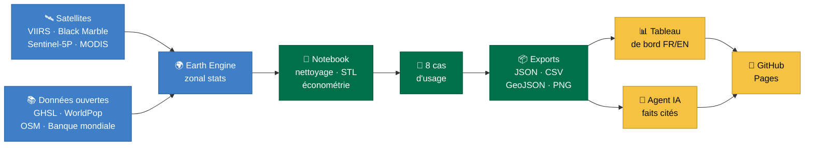


## 🚀 Démarrage rapide

1. **Ouvrir le notebook dans Colab** — [NTL_8_use_cases_FR.ipynb](https://colab.research.google.com/github/samuelguda4/NTL_Mauritius_Project/blob/main/notebooks/NTL_8_use_cases_FR.ipynb).
2. **Choisir le pays** — section 2 : `ISO3 = "TUN"` (tout code ISO 3166-1 alpha-3) et la période ; `SYNTHETIC_TEST = True` exécute tout sans Earth Engine.
3. **Tout exécuter** — *Exécution → Tout exécuter*. Le tableau de bord est exporté dans `dashboard/` et, avec `PUBLISH = True`, publié sur GitHub Pages en un seul appel.

> [!TIP]
> Les clés et jetons se placent dans les **Secrets Colab** (icône 🔑) : `GITHUB_TOKEN` (fine-grained, limité à ce dépôt : *Contents*, *Pages* — plus *Administration* pour créer le dépôt et sa description), et facultativement `GROQ_API_KEY` ou `GEMINI_API_KEY`. Un projet Cloud Earth Engine est nécessaire pour un pays réel.


## 🛰️ Sources de données

| Jeu de données | Fournisseur · ID Earth Engine | Utilisation | Référence |
|---|---|---|---|
| **VIIRS VNL V2 (annual)** | NOAA/EOG · `NOAA/VIIRS/DNB/ANNUAL_V21`, `ANNUAL_V22` | niveaux annuels, cartes, inégalités | Elvidge, C. D. et al. (2021). Annual time series of global VIIRS nighttime lights. *Remote Sensing* 13(5). |
| **VIIRS DNB monthly (VCMSLCFG)** | NOAA/EOG · `NOAA/VIIRS/DNB/MONTHLY_V1/VCMSLCFG` | séries mensuelles, saisonnalité, chocs, tourisme | Elvidge, C. D. et al. (2017). VIIRS night-time lights. *Int. J. Remote Sensing* 38(21). |
| **Black Marble VNP46A2 (daily)** | NASA · `NASA/VIIRS/002/VNP46A2` | indice quotidien des chocs | Román, M. O. et al. (2018). NASA's Black Marble nighttime lights product suite. *RSE* 210. |
| **DMSP-OLS / harmonised DMSP–VIIRS** | NOAA NGDC · Li et al. (sat-io) | série longue depuis 1992 (élasticité au PIB) | Li, X. et al. (2020). A harmonized global nighttime light dataset 1992–2018. *Scientific Data* 7, 168. |
| **GHSL R2023A (POP, SMOD, BUILT-S)** | European Commission JRC · `JRC/GHSL/P2023A/*` | population, urbain/rural, bâti non résidentiel | Schiavina, M. et al. (2023); Pesaresi, M. et al. (2023). GHSL R2023A. JRC. |
| **WorldPop** | WorldPop · `WorldPop/GP/100m/pop` | population (variante) | WorldPop (2018). Global High Resolution Population Denominators. |
| **Sentinel-5P TROPOMI NO₂ / SO₂** | ESA Copernicus · `COPERNICUS/S5P/OFFL/L3_NO2`, `L3_SO2` | contrôle de l'activité, signaux industriels | Veefkind, J. P. et al. (2012). TROPOMI on the ESA Sentinel-5 Precursor. *RSE* 120. |
| **MODIS LST (MOD11A2)** | NASA · `MODIS/061/MOD11A2` | chaleur de surface des sites industriels | Wan, Z. (2014). New refinements and validation of the MODIS LST products. *RSE* 140. |
| **OpenStreetMap** | OpenStreetMap contributors · Overpass API | liste de référence des zones industrielles | © OpenStreetMap contributors, ODbL. |
| **World Bank WDI** | World Bank · `NY.GDP.MKTP.KD`, `NV.IND.TOTL.KD`, `EG.ELC.ACCS.ZS`… | PIB réel, valeur ajoutée industrielle, accès à l'électricité | World Bank (2026). World Development Indicators. |
| **geoBoundaries / FAO GAUL** | William & Mary geoLab · FAO | limites administratives | Runfola, D. et al. (2020). geoBoundaries. *PLoS ONE* 15(4). |


## 📐 Méthodologie et normes de qualité

Méthodologie complète : [docs/methodology.fr.md](docs/methodology.fr.md) · rapport qualité : [docs/QUALITY.fr.md](docs/QUALITY.fr.md).

- **Principes fondamentaux de la statistique officielle (ONU)** — pertinence, impartialité, normes professionnelles, transparence des sources et méthodes, accès ouvert aux résultats.
- **Cadre d'évaluation de la qualité des données (DQAF)** — intégrité, rigueur méthodologique, exactitude et fiabilité, utilité, accessibilité.
- **GSBPM** — chaque section du notebook correspond à une phase du modèle générique du processus statistique.
- **FAIR** — trouvable (URL stables, fichier de citation), accessible (formats ouverts), interopérable (CSV, JSON, GeoJSON), réutilisable (licence, provenance dans `manifest.json`).
- **Statistiques expérimentales** — les estimations par les lumières complètent, sans jamais les remplacer, les statistiques officielles ; elles sont étiquetées *expérimentales*, avec leur incertitude.


| Cas d'usage | Statut | Confiance | Validation |
|---|---|---|---|
| 📈 1 · Dynamiques temporelles | `Expérimental` | élevée | p-value = < 0,0001 |
| 🗺️ 2 · Croissance régionale et convergence | `Expérimental` | moyenne | Spearman ρ = 0,66 |
| 💹 3 · Relation lumières–PIB | `Expérimental` | moyenne | corrélation / EAM (points) = -0,16 / 4,0 |
| ⚡ 4 · Chocs et résilience | `Expérimental` | faible | creux (choc principal) = -1,7 % — non |
| ⚖️ 5 · Inégalités et électrification | `Expérimental` | moyenne | écart moyen (points) = -6,4 |
| 🏭 6 · Zones industrielles | `Expérimental` | faible | précision / rappel / F1 = non disponible |
| 🏖️ 7 · Tourisme saisonnier | `Expérimental` | faible | r = non disponible |
| 🏙️ 8 · Signaux d'urbanisation | `Expérimental` | faible | Spearman ρ = 0,39 |


## 🗂️ Structure du dépôt

```text
.
├── assets/          # images et animations générées à partir des données
├── dashboard/       # → le site est sur la branche gh-pages
├── docs/            # méthodologie et rapport qualité (EN/FR)
├── .github/         # modèles d'issues et de pull requests
├── notebooks/       # le(s) notebook(s) Colab
├── src/             # package d'analyse
├── src_fr/          # package d'analyse (messages en français)
├── CHANGELOG.md     # notes de version
├── CITATION.cff     # citer ce travail
├── CONTRIBUTING.md  # contribuer
├── LICENSE          # MIT (code)
├── README.fr.md     # cette page (français)
└── README.md        # version anglaise
```


## 🔐 Sécurité

- Les jetons et clés d'API ne sont **jamais** écrits sur disque, affichés, journalisés, versionnés ni publiés ; la publication passe par l'API REST GitHub avec un jeton en mémoire, et chaque message d'erreur est expurgé.
- Utiliser un **jeton fine-grained** limité à ce dépôt, avec une date d'expiration ; le révoquer dès qu'il n'est plus utile.
- Chaque fichier est analysé avant chaque envoi ; la publication est annulée si un motif de jeton est trouvé.
- Le site est statique (ni serveur, ni base de données) ; l'assistant IA s'exécute dans le navigateur du visiteur.


## 📝 Citer ce travail

Voir [`CITATION.cff`](CITATION.cff) (bouton *Cite this repository* de GitHub), ou :

```bibtex
@software{ntl_mus_2026,
  author  = {{African Development Bank} and {Data Innovation for Africa (DI4A)}},
  title   = {Night-time lights: eight use cases — Maurice — statistics & public policy, public dashboard and AI agent},
  year    = {2026},
  version = {2.1.0},
  url     = {https://github.com/samuelguda4/NTL_Mauritius_Project}
}
```


## ⚖️ Licence

© AfDB-DI4A (Banque africaine de développement — Data Innovation for Africa). **Toute réutilisation des résultats, cartes, graphiques ou images doit mentionner la source : « Source : AfDB-DI4A ».** Code : [MIT](LICENSE). Les données et images dérivées suivent la licence de chaque source (par exemple, les produits VIIRS de l'EOG, GHSL, WorldPop, geoBoundaries et les WDI de la Banque mondiale sont diffusés sous CC BY 4.0, OpenStreetMap sous ODbL) — consulter la licence de chaque source avant réutilisation.


## 🙏 Remerciements

Développé par la **Banque africaine de développement (BAD)** et **Data Innovation for Africa (DI4A)**. Lumières nocturnes : Earth Observation Group (Payne Institute, Colorado School of Mines) et NASA Black Marble, traitées avec Google Earth Engine.


---
<p align="center"><sub>Généré par le notebook le 2026-10-29 · version 2.1.0 · <a href="https://github.com/samuelguda4/NTL_Mauritius_Project">samuelguda4/NTL_Mauritius_Project</a></sub></p>
