<p align="right"><b>English</b> · <a href="README.fr.md">Français</a></p>

<p align="center"><a href="https://samuelguda4.github.io/NTL_Mauritius_Project/">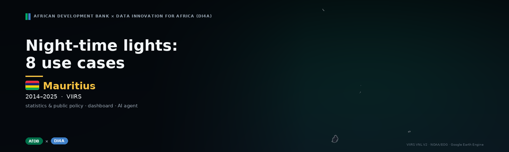</a></p>

<p align="center"><br><b>Mauritius</b> · 2014–2025</p>

<p align="center">Turning satellite night-time lights into evidence for <b>Mauritius</b> — <b>eight use cases</b> for statistics and public policy: economic dynamics, regional growth, GDP nowcasting, shocks and resilience, inequality and electrification, industrial zones, seasonal tourism, urbanisation — with a <b>public dashboard</b> and an <b>AI agent</b> that answers only from the published figures.</p>

<p align="center">
  <a href="https://samuelguda4.github.io/NTL_Mauritius_Project/"></a>
  <a href="https://colab.research.google.com/github/samuelguda4/NTL_Mauritius_Project/blob/main/notebooks/NTL_8_use_cases_EN.ipynb"></a>
  <a href="LICENSE"></a>
  <a href="README.fr.md"></a>
  <a href="docs/methodology.md"></a>
  <a href="https://samuelguda4.github.io/NTL_Mauritius_Project/?country=MUS#assistant"></a>
  <a href="CHANGELOG.md"></a>
</p>

<p align="center"><a href="https://samuelguda4.github.io/NTL_Mauritius_Project/"></a>&nbsp;&nbsp;<a href="https://colab.research.google.com/github/samuelguda4/NTL_Mauritius_Project/blob/main/notebooks/NTL_8_use_cases_EN.ipynb"></a></p>

<p align="center"><a href="https://samuelguda4.github.io/NTL_Mauritius_Project/"><b>https://samuelguda4.github.io/NTL_Mauritius_Project/</b></a></p>


## ✨ At a glance

<sub>Key figures of the run, 2014–2025. Each comes with its confidence level and method on the dashboard.</sub>

<table>
<tr>
<td align="center" width="25%"><h3>+6.6%</h3><b>Annual growth of light</b><br><sub>2014–2025, robust slope (Theil–Sen)</sub></td>
<td align="center" width="25%"><h3>−6.6%</h3><b>Last 12 months vs previous 12</b><br><sub>seasonally adjusted series, up to 12/2025</sub></td>
<td align="center" width="25%"><h3>2.21</h3><b>Light–GDP elasticity</b><br><sub>95% CI 1.24 to 3.18 · confidence medium</sub></td>
<td align="center" width="25%"><h3>0.23</h3><b>Gini of light per capita</b><br><sub>ADM2 units, 2025</sub></td>
</tr>
<tr>
<td align="center" width="25%"><h3>3k</h3><b>People in the dark</b><br><sub>6% of the inhabited population, 2025</sub></td>
<td align="center" width="25%"><h3>22%</h3><b>Share of the top region</b><br><sub>Plaines Wilhems, 2025</sub></td>
<td align="center" width="25%"><h3>16</h3><b>Industrial clusters</b><br><sub>17% of national light</sub></td>
<td align="center" width="25%"><h3>0</h3><b>Tourist zones</b><br><sub>max. summer excess +5% (Plaines Wilhems (Plaines Wilhems))</sub></td>
</tr>
<tr>
<td align="center" width="25%"><h3>+3.9%</h3><b>Lit area</b><br><sub>annual growth; population +0.1%/yr</sub></td>
</tr>
</table>


## ⚡ A shock, seen from space

<p align="center">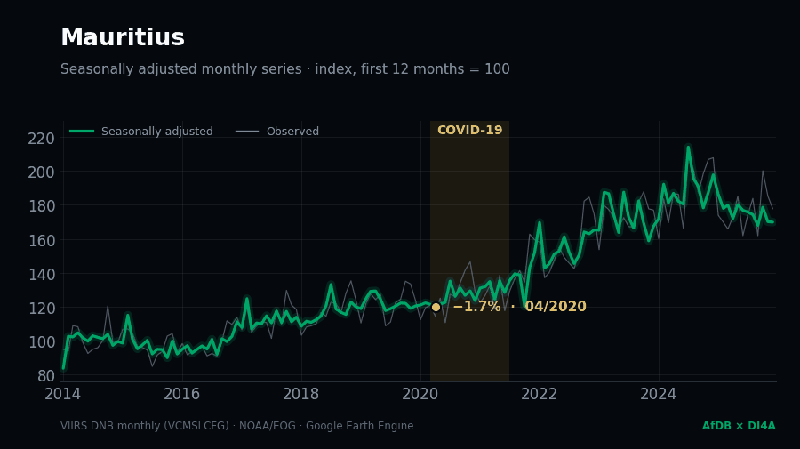<br><sub>National seasonally adjusted monthly series — COVID-19. Trough: −1.7% (04/2020).</sub></p>


## 🧭 Eight use cases

<sub>Each card opens the matching page of the live dashboard.</sub>

<table>
<tr>
<td width="50%" valign="top">
<a href="https://samuelguda4.github.io/NTL_Mauritius_Project/?country=MUS#time">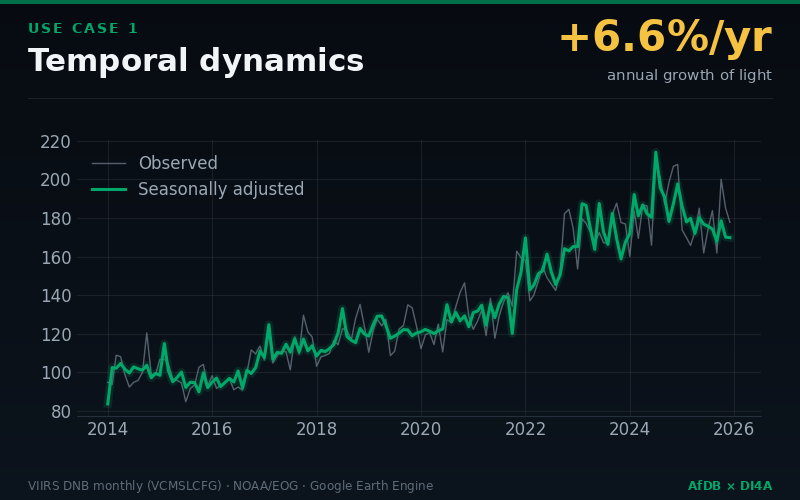</a>
<h3>📈 1 · Time dynamics</h3>
<p><b>Question</b> — <i>Is activity accelerating or slowing down, net of seasonality?</i></p>
<p><b>Finding</b> — Between 2014 and 2025, night-time light in Mauritius changed by +6.6% per year (95% CI: +4.7% to +7.9%). Over the last 12 months, the seasonally adjusted level is -6.6% relative to the previous 12 months.</p>
<p><a href="https://samuelguda4.github.io/NTL_Mauritius_Project/?country=MUS#time">Open the page →</a></p></td>
<td width="50%" valign="top">
<h3>🗺️ 2 · Regional growth and convergence</h3>
<p><b>Question</b> — <i>Which regions take off, which fall behind?</i></p>
<p><b>Finding</b> — Of 12 ADM2 units, 10 show significant growth, 1 are stagnating and 0 are declining. Light remains concentrated: Plaines Wilhems accounts for 22% of national light.</p>
<p><a href="https://samuelguda4.github.io/NTL_Mauritius_Project/?country=MUS#regions">Open the page →</a></p></td>
</tr>
<tr>
<td width="50%" valign="top">
<a href="https://samuelguda4.github.io/NTL_Mauritius_Project/?country=MUS#time">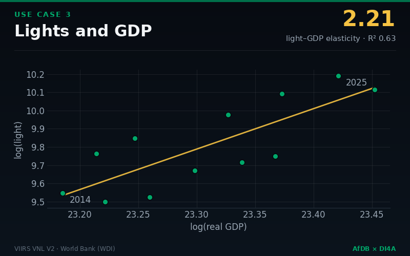</a>
<h3>💹 3 · Light–GDP relationship</h3>
<p><b>Question</b> — <i>Can growth be estimated before its release, and regional GDP?</i></p>
<p><b>Finding</b> — The elasticity of light with respect to real GDP is 2.21 in levels (95% CI: 1.24 to 3.18, R² = 0.63, 12 years) and 0.34 in growth rates (CI: 0.01 to 0.66).</p>
<p><a href="https://samuelguda4.github.io/NTL_Mauritius_Project/?country=MUS#time">Open the page →</a></p></td>
<td width="50%" valign="top">
<a href="https://samuelguda4.github.io/NTL_Mauritius_Project/?country=MUS#shocks">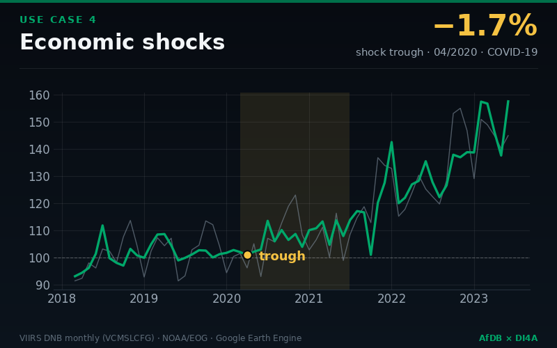</a>
<h3>⚡ 4 · Shocks and resilience</h3>
<p><b>Question</b> — <i>How deep was a shock, and how fast the recovery?</i></p>
<p><b>Finding</b> — The most pronounced shock in the seasonally adjusted series is “COVID-19”: trough of -1.7% (04/2020), return to the pre-shock level after 3 months.</p>
<p><a href="https://samuelguda4.github.io/NTL_Mauritius_Project/?country=MUS#shocks">Open the page →</a></p></td>
</tr>
<tr>
<td width="50%" valign="top">
<h3>⚖️ 5 · Inequality and electrification</h3>
<p><b>Question</b> — <i>Where do people without electricity live?</i></p>
<p><b>Finding</b> — The Gini coefficient of light per capita (ADM2) is 0.23 in 2025 (no significant change since 2014). About 0.00 million people live in inhabited areas with no detectable light (6% of the inhabited population).</p>
<p><a href="https://samuelguda4.github.io/NTL_Mauritius_Project/?country=MUS#inequality">Open the page →</a></p></td>
<td width="50%" valign="top">
<a href="https://samuelguda4.github.io/NTL_Mauritius_Project/?country=MUS#industry">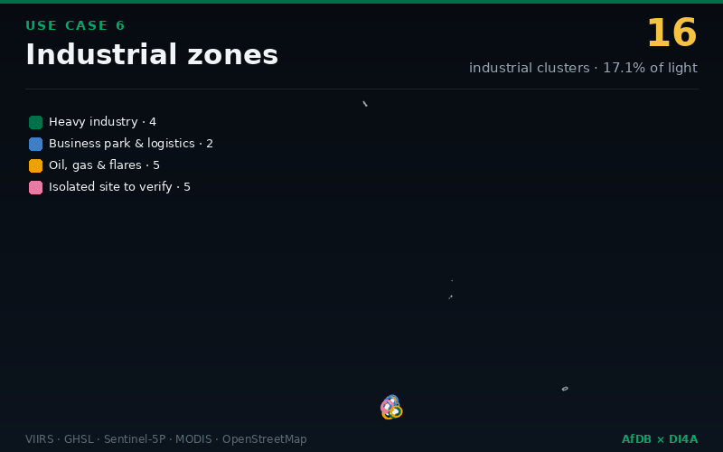</a>
<h3>🏭 6 · Industrial zones</h3>
<p><b>Question</b> — <i>Where is industry, and is its activity growing?</i></p>
<p><b>Finding</b> — 16 industrial clusters detected from concordant satellite signals: 4 heavy industry, 2 business parks & logistics, 5 oil & gas sites and 5 isolated sites to verify. They emit 17.1% of national light (latest year); their light changes by +2.6% per year.</p>
<p><a href="https://samuelguda4.github.io/NTL_Mauritius_Project/?country=MUS#industry">Open the page →</a></p></td>
</tr>
<tr>
<td width="50%" valign="top">
<a href="https://samuelguda4.github.io/NTL_Mauritius_Project/?country=MUS#tourism">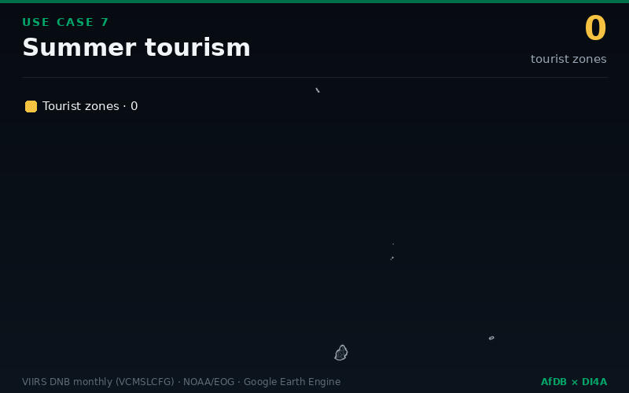</a>
<h3>🏖️ 7 · Seasonal tourism</h3>
<p><b>Question</b> — <i>Which areas live from tourism, and how does the season evolve?</i></p>
<p><b>Finding</b> — No unit shows a significant net summer excess: no tourist season visible from space.</p>
<p><a href="https://samuelguda4.github.io/NTL_Mauritius_Project/?country=MUS#tourism">Open the page →</a></p></td>
<td width="50%" valign="top">
<h3>🏙️ 8 · Urbanisation signals</h3>
<p><b>Question</b> — <i>Where do cities spread, where do villages get electrified, and where does population grow without light?</i></p>
<p><b>Finding</b> — National lit area: +3.9% per year; population: +0.1% per year. Classes (ADM2): Electrified urbanisation 9, Stable or declining 2, Undetermined 1.</p>
<p><a href="https://samuelguda4.github.io/NTL_Mauritius_Project/?country=MUS#urban">Open the page →</a></p></td>
</tr>
<tr>
<td width="50%" valign="top"><h3>🤖 AI agent</h3><p><i>Ask the results in plain language — every number is cited.</i></p><p><a href="https://samuelguda4.github.io/NTL_Mauritius_Project/?country=MUS#assistant">Open the page →</a></p></td>
</tr>
</table>


## 📊 The dashboard

<sub>Bilingual (FR/EN), works offline-first from static files, light & dark themes, mobile-ready.</sub>

<table><tr><td width="76%"><a href="https://samuelguda4.github.io/NTL_Mauritius_Project/">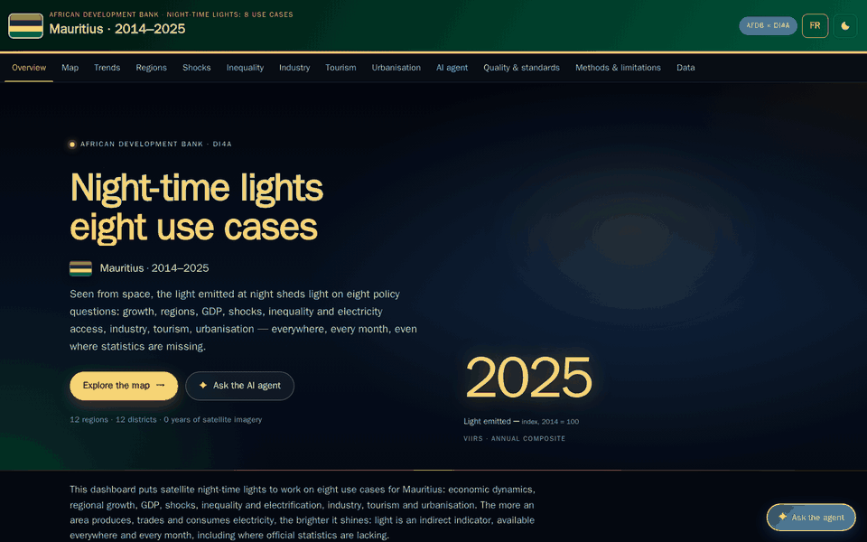</a></td><td width="24%">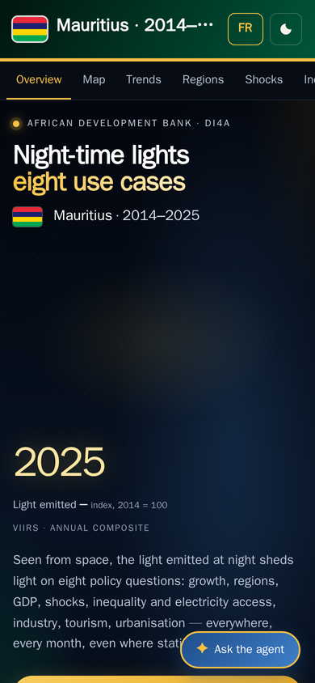</td></tr></table>


<details>
<summary><b>Screenshots</b> (9)</summary>
<br>

<table>
<tr><td width="33%" align="center"><a href="https://samuelguda4.github.io/NTL_Mauritius_Project/?country=MUS#overview">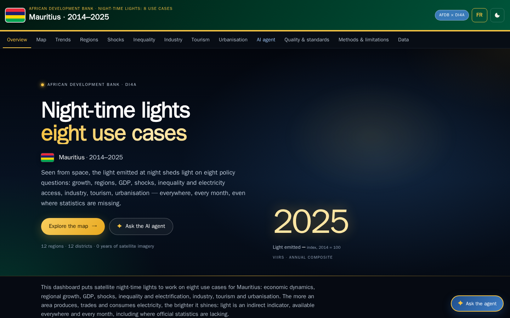</a><br><sub><code>#overview</code></sub></td><td width="33%" align="center"><a href="https://samuelguda4.github.io/NTL_Mauritius_Project/?country=MUS#map">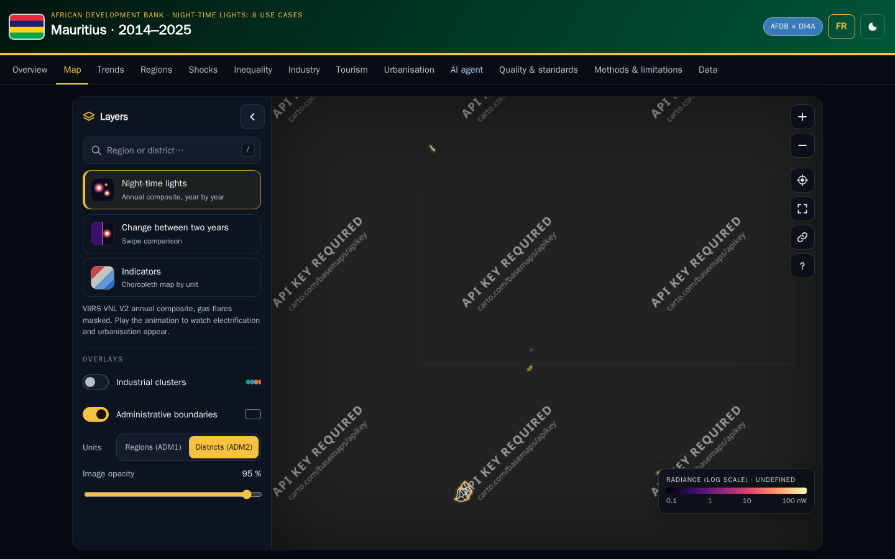</a><br><sub><code>#map</code></sub></td><td width="33%" align="center"><a href="https://samuelguda4.github.io/NTL_Mauritius_Project/?country=MUS#time">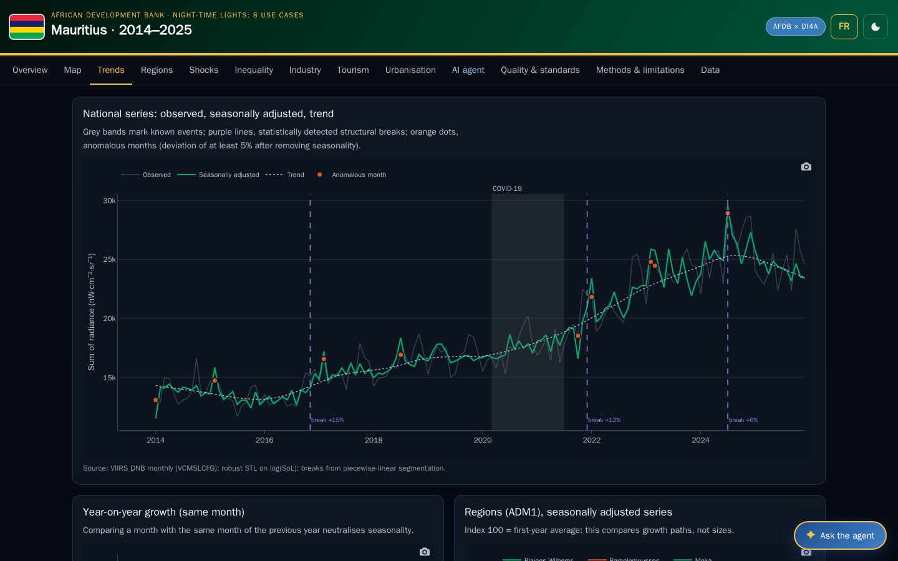</a><br><sub><code>#time</code></sub></td></tr>
<tr><td width="33%" align="center"><a href="https://samuelguda4.github.io/NTL_Mauritius_Project/?country=MUS#regions">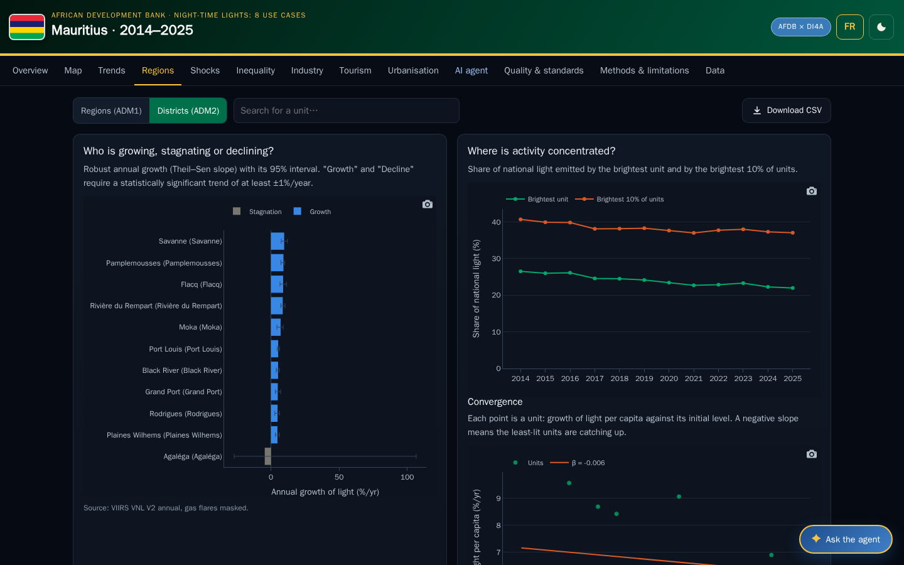</a><br><sub><code>#regions</code></sub></td><td width="33%" align="center"><a href="https://samuelguda4.github.io/NTL_Mauritius_Project/?country=MUS#shocks">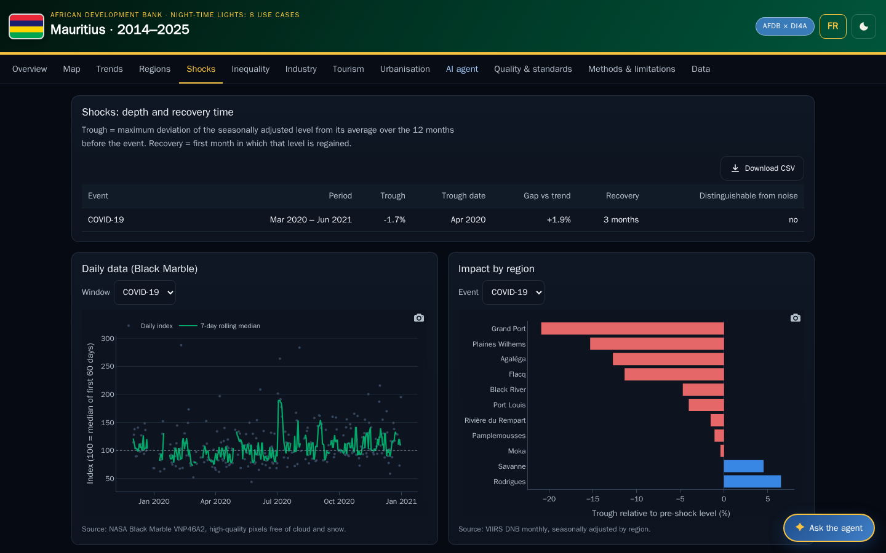</a><br><sub><code>#shocks</code></sub></td><td width="33%" align="center"><a href="https://samuelguda4.github.io/NTL_Mauritius_Project/?country=MUS#inequality">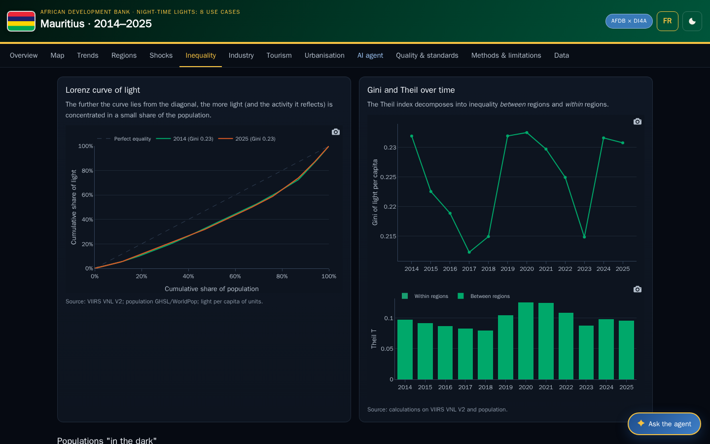</a><br><sub><code>#inequality</code></sub></td></tr>
<tr><td width="33%" align="center"><a href="https://samuelguda4.github.io/NTL_Mauritius_Project/?country=MUS#industry">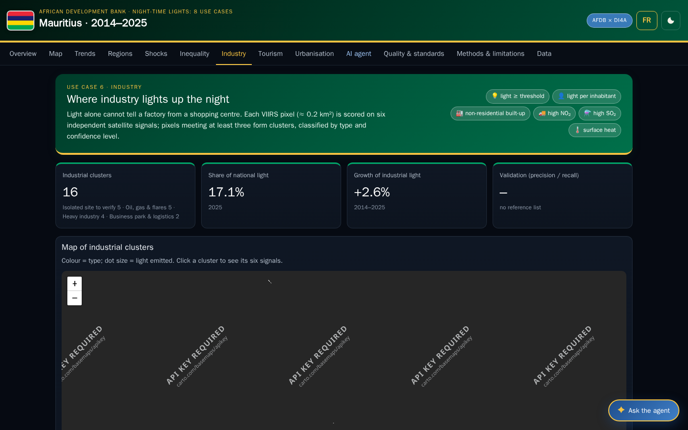</a><br><sub><code>#industry</code></sub></td><td width="33%" align="center"><a href="https://samuelguda4.github.io/NTL_Mauritius_Project/?country=MUS#tourism">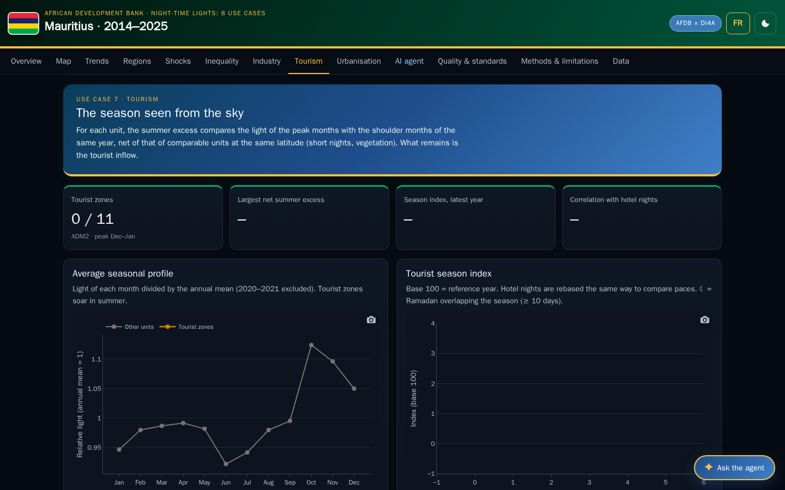</a><br><sub><code>#tourism</code></sub></td><td width="33%" align="center"><a href="https://samuelguda4.github.io/NTL_Mauritius_Project/?country=MUS#urban">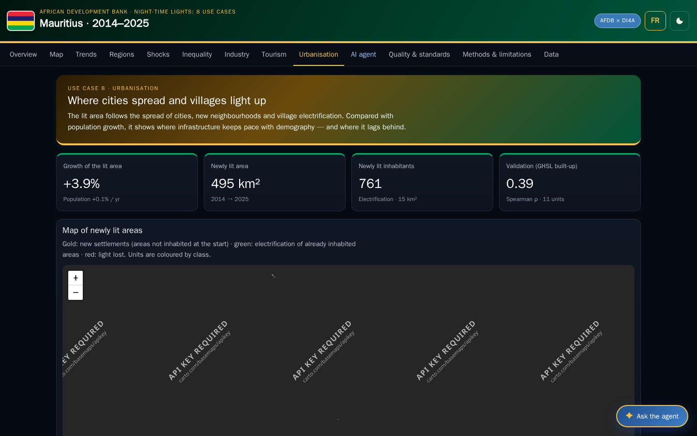</a><br><sub><code>#urban</code></sub></td></tr>
</table>
</details>


## 🤖 The AI agent

- **Grounded.** The agent only answers from the numbered facts exported with the dashboard (`agent_context.json`, F01, F02…): the same facts in the notebook and on the website.
- **Cited.** Every quantitative sentence cites its fact, e.g. `[F12]`; citations link to the dashboard page they come from, and unknown citations are removed.
- **A real agent with six tools.** It plans, calls tools by *function calling* and chains several steps: 🔎 `search_facts`, 🏆 `rank_units`, 📍 `unit_profile`, ⚖️ `compare_units`, 📈 `make_chart` (charts drawn in the conversation) and 🗺️ `map_action` (it drives the dashboard map: year, swipe comparison, zoom, layers). Each step is shown; tool results are cited as `[D2]`.
- **Briefs in one click.** Policy brief, country profile or parliamentary answer — structured, sourced, exportable as Markdown or PDF.
- **Your choice of model.** Groq (`openai/gpt-oss-120b` by default), Google Gemini or a local Ollama model, with streamed answers; without any model, an offline planner runs the same tools.
- **Guard-rails.** Read-only tools, at most five tool calls per question, data never treated as instructions (prompt-injection resistant), rate limiting.
- **Keys stay with you.** On the website, a visitor's API key stays in their own browser and is sent only to the chosen provider; in the notebook keys come from Colab Secrets. No key is ever published.


## 🛠️ How it works

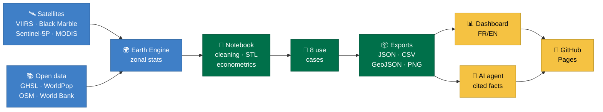


## 🚀 Quick start

1. **Open the notebook in Colab** — [NTL_8_use_cases_EN.ipynb](https://colab.research.google.com/github/samuelguda4/NTL_Mauritius_Project/blob/main/notebooks/NTL_8_use_cases_EN.ipynb).
2. **Set the country** — in section 2, `ISO3 = "TUN"` (any ISO 3166-1 alpha-3 code) and the period; `SYNTHETIC_TEST = True` runs everything without Earth Engine.
3. **Run all** — *Runtime → Run all*. The dashboard is exported to `dashboard/` and, with `PUBLISH = True`, published to GitHub Pages in one call.

> [!TIP]
> Keys and tokens go in **Colab Secrets** (🔑 icon): `GITHUB_TOKEN` (fine-grained, this repository only: *Contents*, *Pages* — plus *Administration* to create the repository and set its description), and optionally `GROQ_API_KEY` or `GEMINI_API_KEY`. An Earth Engine Cloud project is needed for real countries.


## 🛰️ Data sources

| Dataset | Provider · Earth Engine ID | Used for | Reference |
|---|---|---|---|
| **VIIRS VNL V2 (annual)** | NOAA/EOG · `NOAA/VIIRS/DNB/ANNUAL_V21`, `ANNUAL_V22` | annual levels, maps, inequality | Elvidge, C. D. et al. (2021). Annual time series of global VIIRS nighttime lights. *Remote Sensing* 13(5). |
| **VIIRS DNB monthly (VCMSLCFG)** | NOAA/EOG · `NOAA/VIIRS/DNB/MONTHLY_V1/VCMSLCFG` | monthly series, seasonality, shocks, tourism | Elvidge, C. D. et al. (2017). VIIRS night-time lights. *Int. J. Remote Sensing* 38(21). |
| **Black Marble VNP46A2 (daily)** | NASA · `NASA/VIIRS/002/VNP46A2` | daily shock index | Román, M. O. et al. (2018). NASA's Black Marble nighttime lights product suite. *RSE* 210. |
| **DMSP-OLS / harmonised DMSP–VIIRS** | NOAA NGDC · Li et al. (sat-io) | long series since 1992 (GDP elasticity) | Li, X. et al. (2020). A harmonized global nighttime light dataset 1992–2018. *Scientific Data* 7, 168. |
| **GHSL R2023A (POP, SMOD, BUILT-S)** | European Commission JRC · `JRC/GHSL/P2023A/*` | population, urban/rural, non-residential built-up | Schiavina, M. et al. (2023); Pesaresi, M. et al. (2023). GHSL R2023A. JRC. |
| **WorldPop** | WorldPop · `WorldPop/GP/100m/pop` | population (alternative) | WorldPop (2018). Global High Resolution Population Denominators. |
| **Sentinel-5P TROPOMI NO₂ / SO₂** | ESA Copernicus · `COPERNICUS/S5P/OFFL/L3_NO2`, `L3_SO2` | activity cross-check, industrial signals | Veefkind, J. P. et al. (2012). TROPOMI on the ESA Sentinel-5 Precursor. *RSE* 120. |
| **MODIS LST (MOD11A2)** | NASA · `MODIS/061/MOD11A2` | surface heat of industrial sites | Wan, Z. (2014). New refinements and validation of the MODIS LST products. *RSE* 140. |
| **OpenStreetMap** | OpenStreetMap contributors · Overpass API | industrial-area reference list | © OpenStreetMap contributors, ODbL. |
| **World Bank WDI** | World Bank · `NY.GDP.MKTP.KD`, `NV.IND.TOTL.KD`, `EG.ELC.ACCS.ZS`… | real GDP, industry value added, electricity access | World Bank (2026). World Development Indicators. |
| **geoBoundaries / FAO GAUL** | William & Mary geoLab · FAO | administrative boundaries | Runfola, D. et al. (2020). geoBoundaries. *PLoS ONE* 15(4). |


## 📐 Methodology & quality standards

Full methodology: [docs/methodology.md](docs/methodology.md) · quality report: [docs/QUALITY.md](docs/QUALITY.md).

- **UN Fundamental Principles of Official Statistics** — relevance, impartiality, professional standards, transparency of sources and methods, open access to the results.
- **Data Quality Assessment Framework (DQAF)** — integrity, methodological soundness, accuracy and reliability, serviceability, accessibility.
- **GSBPM** — every notebook section maps to a phase of the Generic Statistical Business Process Model.
- **FAIR** — findable (stable URLs, citation file), accessible (open formats), interoperable (CSV, JSON, GeoJSON), reusable (licence, provenance in `manifest.json`).
- **Experimental statistics** — night-light estimates complement, and never replace, official statistics; they are labelled *experimental* with their uncertainty.


| Use case | Status | Confidence | Validation |
|---|---|---|---|
| 📈 1 · Time dynamics | `Experimental` | high | p-value = < 0.0001 |
| 🗺️ 2 · Regional growth and convergence | `Experimental` | medium | Spearman ρ = 0.66 |
| 💹 3 · Light–GDP relationship | `Experimental` | medium | correlation / MAE (pp) = -0.16 / 4.0 |
| ⚡ 4 · Shocks and resilience | `Experimental` | low | trough (main shock) = -1.7% — no |
| ⚖️ 5 · Inequality and electrification | `Experimental` | medium | mean gap (pp) = -6.4 |
| 🏭 6 · Industrial zones | `Experimental` | low | precision / recall / F1 = not available |
| 🏖️ 7 · Seasonal tourism | `Experimental` | low | r = not available |
| 🏙️ 8 · Urbanisation signals | `Experimental` | low | Spearman ρ = 0.39 |


## 🗂️ Repository structure

```text
.
├── assets/          # images & animations generated from the data
├── dashboard/       # → the live site is on the gh-pages branch
├── docs/            # methodology and quality report (EN/FR)
├── .github/         # issue and pull-request templates
├── notebooks/       # the Colab notebook(s)
├── src/             # analysis package
├── src_fr/          # analysis package (French messages)
├── CHANGELOG.md     # release notes
├── CITATION.cff     # how to cite
├── CONTRIBUTING.md  # how to contribute
├── LICENSE          # MIT (code)
├── README.fr.md     # French version
└── README.md        # this page (English)
```


## 🔐 Security

- Tokens and API keys are **never** written to disk, printed, logged, committed or published; publication uses the GitHub REST API with an in-memory token and redacts every error message.
- Use a **fine-grained token** limited to this repository, with an expiry date; revoke it when it is no longer needed.
- Every file is scanned for token patterns before each push; the publication is cancelled if one is found.
- The site is static (no server, no database); the AI assistant runs in the visitor's browser.


## 📝 How to cite

See [`CITATION.cff`](CITATION.cff) (GitHub shows a *Cite this repository* button), or:

```bibtex
@software{ntl_mus_2026,
  author  = {{African Development Bank} and {Data Innovation for Africa (DI4A)}},
  title   = {Night-time lights: eight use cases — Mauritius — statistics & public policy, public dashboard and AI agent},
  year    = {2026},
  version = {2.1.0},
  url     = {https://github.com/samuelguda4/NTL_Mauritius_Project}
}
```


## ⚖️ License

© AfDB-DI4A (African Development Bank — Data Innovation for Africa). **Any reuse of the results, maps, charts or images must state the source: “Source: AfDB-DI4A”.** Code: [MIT](LICENSE). Derived data and images follow the licence of each source dataset (for example, EOG VIIRS products, GHSL, WorldPop, geoBoundaries and World Bank WDI are distributed under CC BY 4.0, OpenStreetMap under ODbL) — see each source's licence before reuse.


## 🙏 Acknowledgements

Developed by the **African Development Bank (AfDB)** and **Data Innovation for Africa (DI4A)**. Night-time lights by the Earth Observation Group (Payne Institute, Colorado School of Mines) and NASA Black Marble, processed with Google Earth Engine.


---
<p align="center"><sub>Generated by the notebook on 2026-10-29 · version 2.1.0 · <a href="https://github.com/samuelguda4/NTL_Mauritius_Project">samuelguda4/NTL_Mauritius_Project</a></sub></p>
